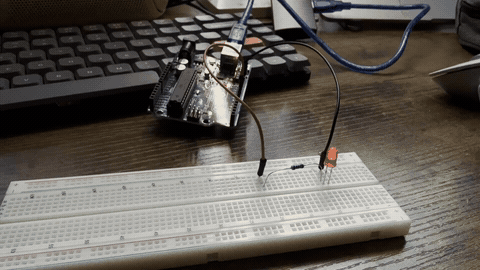

# Fading LED with Arduino

An Arduino Uno project that gradually brightens an LED for **2 seconds**, dims it for **2 seconds**, stays off for **0.5 seconds**, and repeats. The circuit was designed in Tinkercad and demonstrated on physical hardware.

## Demo

The animated preview below plays directly in this README. It is generated from the supplied hardware recording; its restart follows the recording length, while the Arduino's programmed cycle is 4.5 seconds.

**[Watch or download the MP4 demo](media/fading-led-demo.mp4)** · [Original recording](media/original/IMG_0106.mp4)

The playback copy uses 8-bit H.264 video and AAC audio for browser compatibility. The original 10-bit recording is preserved unchanged. The GIF is silent; open the MP4 for the full recording with audio.

## Circuit diagram

## Components and wiring

- Arduino Uno and USB cable
- Breadboard
- One LED
- One current-limiting resistor (220–330 Ω is suitable for a typical red LED on a 5 V Uno)
- Jumper wires

Connect **pin 9 → resistor → LED anode (+)**, then **LED cathode (−) → GND**. The anode is normally the longer leg; the cathode is normally the shorter leg and the side with the flat edge. Keep the resistor in series with the LED.

On the pictured breadboard, pin 9 connects to row 21, the resistor joins rows 21 and 10, and the LED joins rows 10 and 9. Row 9 connects to GND. Holes a–e in a numbered row are connected together; the center gap separates them from f–j.

## Run the project

### Arduino IDE

1. Download or clone this repository.
2. Open [`Fading_led/Fading_led.ino`](Fading_led/Fading_led.ino). The folder and sketch share the same name so the Arduino IDE can open them together.
3. Connect the circuit and Arduino to your computer.
4. Select **Arduino Uno** and your board's port in the IDE.
5. Click **Verify**, then **Upload**. The fade sequence repeats automatically.

### Tinkercad Circuits

1. Recreate the circuit shown above with an Uno, LED, resistor, and breadboard.
2. Open **Code → Text** and paste the sketch.
3. Click **Start Simulation**.

## Timing

| Time within each cycle | LED behavior | PWM value |
| --- | --- | --- |
| 0–2 seconds | Fade up | 0 toward 255 |
| 2–4 seconds | Fade down | 255 toward 0 |
| 4–4.5 seconds | Stay off | 0 |
| After 4.5 seconds | Start again | Repeats |

The code updates roughly every 5 ms. Actual values are sampled at these intervals, so the timing and brightness endpoints are approximate.

## How the code works

The supplied sketch is preserved unchanged in [`Fading_led/Fading_led.ino`](Fading_led/Fading_led.ino).

| Statement | Explanation |
| --- | --- |
| `const int ledPin = 9;` | Names pin 9 as the LED output. `const` keeps this pin number fixed. |
| `void setup()` | Runs once when the Arduino starts or resets. |
| `pinMode(ledPin, OUTPUT);` | Configures pin 9 to output a signal. |
| `void loop()` | Runs repeatedly while the Arduino is powered. |
| `unsigned long cycleTime = millis() % 4500;` | Gets elapsed milliseconds and takes the remainder after division by 4500. The resulting cycle position normally runs from 0 to 4499, then restarts. `unsigned long` is the type used for this timer. |
| `int brightness;` | Declares the whole-number brightness value assigned by the conditions below. |
| `if (cycleTime < 2000)` | Selects the first two seconds of the cycle. |
| `map(cycleTime, 0, 2000, 0, 255)` | Converts increasing time into increasing brightness. |
| `else if (cycleTime < 4000)` | Selects the next two seconds, because the first condition has already failed. |
| `map(cycleTime, 2000, 4000, 255, 0)` | Converts increasing time into decreasing brightness. |
| `else` / `brightness = 0;` | Turns the LED off during the remaining half second. |
| `analogWrite(ledPin, brightness);` | Applies the calculated PWM duty cycle to pin 9. On an Uno, 0 is always off and 255 is always on. |
| `delay(5);` | Pauses for 5 ms before the next update. |

Braces `{ }` group the statements belonging to each function or condition. A semicolon `;` ends a statement. Text after `//` or inside `/* ... */` is a comment and does not run.

### Why pin 9?

Pin 9 supports **pulse-width modulation (PWM)** and is marked `~` on the Uno. PWM switches the output rapidly between on and off. Changing the proportion of time it is on changes the LED's apparent brightness. The `map()` calls make the PWM value change linearly; human perception of brightness is not perfectly linear.

### Change the effect

- **Choose another pin:** change `ledPin` and move the wire to another Uno PWM pin: 3, 5, 6, 9, 10, or 11.
- **Change the fade timing:** update both `map()` time ranges, the `if` boundaries, and the total used by `%` together. For example, 3 seconds up + 3 seconds down + 1 second off uses boundaries 3000 and 6000, and a total of 7000 ms.
- **Reduce maximum brightness:** replace the brightness endpoint `255` in both `map()` calls with a lower value.

## Files

| File | Purpose |
| --- | --- |
| `Fading_led/Fading_led.ino` | Original Arduino sketch |
| `media/Smashing Elzing.png` | Original Tinkercad circuit image |
| `media/original/IMG_0106.mp4` | Original hardware recording |
| `media/fading-led-demo.mp4` | Browser-compatible video copy |
| `media/fading-led-demo.gif` | Automatically looping README preview |

## Troubleshooting

- **LED stays off:** check its polarity, the GND connection, breadboard rows, and that the signal wire is on pin 9.
- **LED switches abruptly:** confirm that you are using a PWM pin and `analogWrite()`.
- **Upload fails:** check the selected board, port, and USB cable.
- **Video does not play in a particular browser:** use the GIF preview, or download the compatible MP4 and open it in a video player.

## Verification notes

The PNG was decoded successfully, the recording was inspected at multiple timestamps, and the converted MP4 was decoded end to end. The GIF was generated from the recording. The sketch was reviewed against the requested timing; it was not compiled or uploaded to a connected Arduino during README preparation.
